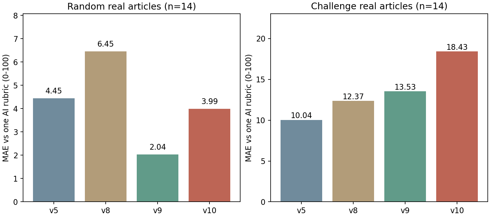

# v10: 잔존 피해 문맥 검증과 직접 판정 42건 적용

**새 문맥 모델은 검증에 실패해 기본 모델로 채택하지 않았다.** 대신 새로 직접 읽은 실제 기사 42건(v9 14건·v10 28건)의 판정을 현재 평가 경로에 적용했다. 현재 직접 AI 판정은 1,074건이며, 기존 전체 점수에서 위험 지수가 바뀐 기사는 19건이다. 알려진 기사를 정정한 것은 새로운 기사에 대한 모델 정확도 향상의 증거가 아니다.

[28건 순수 모델 비교](../data/risk/20261116_v10/test_results.csv) · [42건 적용 내역·원문 링크](../data/risk/20261116_v10/applied_review_changes.csv) · [현재 판정 카탈로그 명세](../data/risk/review_catalogs.json)

## 시도한 수정

v9는 낮은 점수를 0으로 보정하면서 실제 피해도 지웠다. v10은 원래 점수와 본문의 치료·재활·미지급·체납·완료·가상·지원 등의 문맥 특징으로 **잔존 위해가 있는지 분류**하고, 위해가 있는 사례만으로 학습한 중앙값 보정값을 결합했다. 낮은 원래 점수라도 문맥이 다르면 다른 결과를 낼 수 있다. 단어 하나가 점수를 강제하지 않으며 기사 ID·입력 JSON에 적힌 기대 점수는 사용하지 않는다.

기존 개발 OOF 1,043건과 이미 열어 본 v8 확인 48건·v9 확인 14건을 개발로 전환해 1,105건을 사용했다. 고정된 4개 구성(C=.1/1, soft/hard)을 사건 가족별 4중 검증으로 비교해 C=.1의 hard 구성을 선택했다. 원래 v8 가중치나 v9 보정 함수는 바꾸지 않았다. 원래 모델의 과거 OOF 분할과 새 보정기 분할은 완전히 중첩된 검증이 아니므로, 개발 수치를 독립 정확도로 부르지 않는다.

## 새 실제 기사 28건의 확인

7개 매체에서 무작위 2건씩 14건을 주 표본으로 뽑았다. 별도로 피해·해소·지원 표현이 많은 미판정 기사 중 매체별 2건씩 14건을 뽑아 검증용 보조 표본으로 삼았다. 이는 전체 뉴스 분포의 대표 표본이 아니다. 모두 이전 1,046건의 판정 및 자동 관련 사건 가족을 제외한 저장 코퍼스의 실제 기사이며, 새 다운로드나 합성 기사는 없다.

모델·소스·선택·개발 기록은 `0d68b47`에 먼저 봉인했다. 그 뒤 본문 전체를 읽고 N/T/A/S/L/I/X·상태·근거를 작성해 `f00cb5d`에 저장한 다음 결과를 열었다. 이후 모델·기준 판정·표본을 고치지 않았다. 보조 표본 19/24번은 같은 재건축 부담금 정책을 다룬다는 관계를 본문을 읽을 때 발견했고, 예측 전에 기록했다. 두 기사를 제외하거나 독립 사건이라고 주장하지 않았다.

기준은 현재 AI 한 명의 판정이다. 사실 검증·독립 사람 정답·실제 위해 확률이 아니다.

| 표본 | 모델 | 평균 절대오차 | 10점 이내 일치 | 기준 30점 이상 탐지 | 실제 위해를 0으로 만든 수 |
|---|---|---:|---:|---:|---:|
| 무작위 14건 | v5 | 4.45 | 11/14 | 0/1 | 2/3 |
| 무작위 14건 | v9 | 2.04 | 13/14 | 0/1 | 1/3 |
| 무작위 14건 | v10 | 3.99 | 11/14 | 0/1 | 1/3 |
| 보조 14건 | v5 | 10.04 | 10/14 | 1/5 | 1/10 |
| 보조 14건 | v9 | 13.53 | 6/14 | 1/5 | 1/10 |
| 보조 14건 | v10 | 18.43 | 5/14 | 1/5 | 5/10 |



문맥을 추가하는 것만으로 충분하지 않았다. 본문 전체의 단서 수로 학습한 분류기는 지원·개선 기사 안의 잔존 피해를 여전히 놓치고, 일반 의학 안내를 확정 피해로 과대평가하기도 했다. 무작위 표본에서는 v5보다 평균 오차가 작았지만 v9보다 나빴고, 보조 표본에서는 악화했다. 사전 조건을 통과하지 못해 **v10은 명시적으로 선택하는 실험 모델로만 남긴다.** 이 28건의 모델 결과를 직접 판정으로 덮은 뒤 정확도가 좋아졌다고 계산하지 않았다.

## 실제 적용 경로의 수정

이전에는 카탈로그 한 파일만 읽었다. 이제 해시로 확인한 기존 1,032건과 추가 원장 14건·28건을 함께 읽는다. 기존 파일과 과거 보고서는 덮어쓰지 않고 추가 판정을 별도 JSONL에 저장했다.

- [v9 실제 기사 판정 14건](../data/risk/20261116_v9/review_patch.jsonl)
- [v10 실제 기사 판정 28건](../data/risk/20261116_v10/review_patch.jsonl)
- [현재 파일 목록·해시](../data/risk/review_catalogs.json)

**제목과 정제 본문 해시가 모두 같은 버전**에만 직접 판정을 재사용한다. 바뀐 본문·제목에는 예전 판정을 붙이지 않는다. 파일 해시가 명세와 다르거나 여러 원장에 같은 버전이 중복되면 중단한다. 출력에는 실제로 사용한 원장의 해시와 `direct_Codex_session_judgment`를 남긴다. 미판정 기사는 기존 v5 순수 모델 출력으로 구별한다. 숫자 미완성 방송 초안은 계속 차단한다.

현재 기본 CLI의 판정 원장은 1,074건이다. 보존된 HTML/전체 점수 스냅샷은 1,032건 시점이다. 최신 전체 표는 스냅샷과 추가 원장으로 재구성할 수 있으며 8,128건과 연구 포함 여부·기존 모델 출력은 유지한다. 원래 스냅샷에서 위험 지수가 달라진 것은 새 판정 중 19건이다. 예를 들어 지원금 지급이 복구 완료를 뜻하지 않는 공공시설 복구 기사, 진료 편의가 개선돼도 도뇨관 제거가 어려운 환자 기사의 판정을 적용했다.

## 실행

```bash
# 최신 직접 판정 1,074건 + 나머지 기사 v5 모델
python -m news_flywire.risk_review_updates my_articles.jsonl --output my_scores.jsonl

# 원장을 지정하려면 --catalog를 반복 가능; 과거 결과도 재현 가능
python -m news_flywire.risk_review_updates my_articles.jsonl \
  --catalog data/risk/20261110_followup/review_catalog.jsonl --output historical_scores.jsonl

# 최신 8,128건 전체 점수 CSV/Parquet 재구성. 기존 출력 폴더는 덮어쓰지 않음
python scripts/export_current_risk_scores.py --out data/derived/current_risk_scores

# 채택하지 않은 실험 모델의 순수 출력
python -m news_flywire.risk_inference my_articles.jsonl \
  --model data/risk/20261116_v10/model.joblib --output experimental_scores.jsonl

python scripts/audit_context_risk.py
python -m pytest -q
```

현재 환경에는 최신 전체 표도 `data/raw/risk/20261116_v10/current_export/`에 생성했다. 원문과 특징 캐시는 Git에서 제외하며, 원장·모델·예측·해시·내보내기 코드·검증 기록은 커밋한다.

전체 테스트 **125개 통과**. 같은 원래 점수라도 서로 다른 피해 문맥을 구분할 수 있는지, 단일 분류만 있는 학습 자료, 잘못된 입력, 중복 원장·명세 해시 불일치를 검사했다. 감사 스크립트로 1,105건 학습 재현·새 28건 순수 예측·판정 해시를 검증했다. 실제 1,073건의 정확 버전 재사용과 초안 1건 차단, 명령행의 새 실제 42건 직접 판정·합성 2건 모델 분기, 실험 모델의 순수 출력 3건, 전체 표의 19건 정정을 별도로 확인했다. 원장 적용 무결성을 정확도 증거로 세지 않는다.
