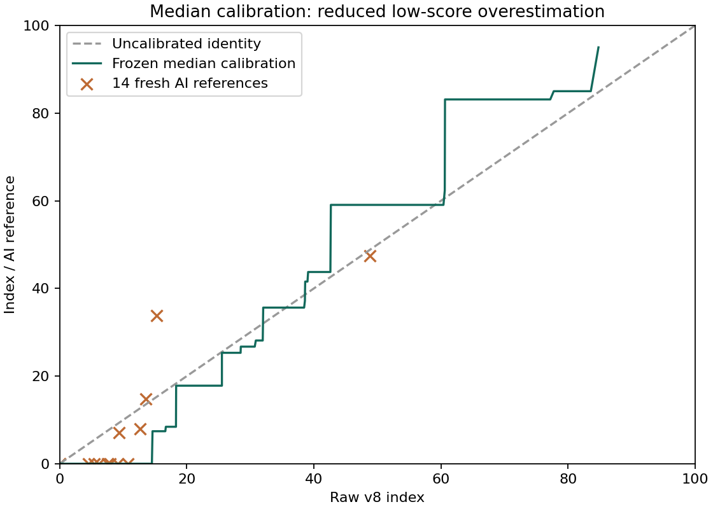

# v9: 무해 기사 과대평가를 줄이는 점수 보정

v8의 낮은 양수 점수에 남은 과대평가를 줄이는 보정기를 추가했다. **새 실제 기사 14건에서 v8 대비 평균 절대오차는 5.68→4.84점, 무해 기사에 10점을 넘게 준 경우는 1→0건이었다.** 그러나 10점 이내 일치는 12→11건으로 줄었고 최대 오차도 늘었다. 사전 보호 조건을 모두 통과하지 못해 기본 모델·배포 점수·직접 판정 카탈로그는 바꾸지 않았다. v9는 명시적으로 선택하는 실험 모델이다.

[기사별 결과](../data/risk/20261116_v9/test_results.csv) · [사전 기준](../data/risk/20261116_v9/protocol.json) · [통계](../data/risk/20261116_v9/test_metrics.json) · [보정 함수](../data/risk/20261116_v9/mapping.csv)

## 변경 내용

기존 v8 개발 자료 1,043건의 사건 그룹 교차검증 예측과 직접 AI 판정을 사용했다. 3~12점대로 예측된 기사 다수의 기준값은 0이었다. 학습 자료에 대한 적합 예측을 다시 보정하면 오차를 과소평가할 수 있어, 저장된 OOF 예측에만 보정 함수를 적합했다. v8 최종 확인용 48건의 판정은 적합에 넣지 않았다.

보정은 사건 가족별 가중치 합이 같도록 한 **중앙값 등위 회귀**다. 가중 절대오차를 최소화하며 원래 점수가 올라갈 때 보정 점수가 내려가지 않게 한다. 단어·기사 ID별 임계값을 넣지 않았다. 중앙값 분위 .5는 고정했고 매개변수 탐색을 하지 않았다. 범위 밖 입력은 양 끝 보정값으로 제한한다. 위험 확률 보정은 아니다.

v8 가중치와 기존 특징·결과는 수정하지 않았다. v9 파일은 보정 함수와 고정 v8 파일의 경로·해시를 저장한다. 실행 시 v8 해시를 확인하며 원본이 바뀌면 중단한다. 기존 새 기사 평가 CLI에서도 같은 인터페이스로 실행된다.



낮은 점수를 0으로 모으는 것이 무해 기사에는 도움이 되지만, 낮게 평가된 실제 피해도 함께 지울 수 있다. 이 한계는 아래 결과에 남겼다.

## 새로운 확인 자료와 절차

- 저장된 한국어 뉴스 중 이전 1,032건의 직접 판정 및 관련 사건 가족을 제외했다. 새로 다운로드한 자료는 아니다.
- 7개 매체에서 2건씩 무작위 선택했다. SBS는 남은 미판정 사건군이 부족해 제외했다. 시드와 14건 선택을 먼저 저장했다.
- 모델·소스·보정 함수·선택 해시를 `cd75e4e`에 고정했다. 이후 정제 본문 전문 14건을 읽고 판정한 원장을 `c27e86e`에 커밋한 뒤 예측을 열었다.
- 기준은 같은 세션 AI 한 명의 N/T/A/S/L/I/X·상태·근거다. 독립 사람 정답, 사실 검증이나 미래 위험 확률은 아니다. 새 합성 기사는 사용하지 않았다.
- 한 모델·한 확인 집합만 사용했다. 결과를 본 뒤 모델·보정 함수·판정·표본을 고치지 않았다.

## 새 실제 기사 14건 결과

| 지표 | 기존 v5 | 원래 v8 | 보정 v9 |
|---|---:|---:|---:|
| 평균 절대오차 | 5.02 | 5.68 | 4.84 |
| 10점 이내 일치 | 11/14 | 12/14 | 11/14 |
| 무해 기사에서 10점 초과 | 0/9 | 1/9 | 0/9 |
| 기준 30점 이상 탐지 | 0/2 | 1/2 | 1/2 |
| 최대 오차 | 22.29 | 18.47 | 26.33 |

매체 내에서 기사 쌍을 재표집한 평균 오차 감소의 조건부 95% 범위는 v5 대비 **−1.17~1.53점**, v8 대비 **−2.05~3.74점**이다. 표본이 작고 두 범위 모두 0을 포함하므로 일반적인 정확도 향상을 입증하지 못했다. 이 범위는 AI 판정 자체의 불확실성도 반영하지 않는다.

| 사례 | AI 기준 | v8 | v9 | 해석 |
|---|---:|---:|---:|---|
| 재판 중단에 대한 고발 | 0.00 | 10.75 | 0.00 | 고발인의 법적 주장만으로 구체적인 새 피해를 확정하지 않음 |
| 법률 전략의 가정·칼럼 | 0.00 | 9.18 | 0.00 | 손실·위험이라는 일반 예시를 현재 사건과 구분 |
| 로켓 시험발사 계획 | 0.00 | 5.39 | 0.00 | 기술 소개를 실제 사고로 보지 않음 |
| 배송·접근성 문제의 비문학 책 소개 | 14.84 | 13.54 | 0.00 | 실제 구조적 제약을 보정 과정에서 지운 오류 |
| 시장 시설 문제·운영 지연 | 33.75 | 15.28 | 7.42 | 이미 낮았던 계속되는 경제 피해 점수를 더 낮춘 오류 |
| 장중 주가지수 급락 | 47.50 | 48.82 | 59.06 | 고점 보정으로 오히려 과대평가한 사례 |

**무해 기사 과대평가는 줄었으나 실제 낮은 위해까지 지우는 문제가 남았다.** v5·v8 양쪽 대비 평균 오차·일치율·고위험 탐지를 보존해야 한다는 사전 조건 중 v8 대비 일치율을 충족하지 못했다. 따라서 기존 기본 모델 v5와 최신 적용 점수 8,128건·직접 판정 1,032건은 유지한다. 새 판정 14건은 실험 원장에 제공하며 배포 카탈로그에 자동 합치지 않았다.

## 이전 오류에 대한 재확인

이전 v8 최종 확인 48건에도 고정 보정기를 적용했다. 실제 16건의 MAE는 7.25→2.23점, 합성 32건은 18.36→14.35점이었다. 다만 이 자료의 실패를 본 것이 보정 방법을 선택한 계기이므로 **사후 진단**이다. 새 독립 확인이나 이번 14건과 합친 정확도 증거로 사용하지 않았다. 원래 v8 결과는 그대로 보존했다.

## 실행과 검증

```bash
# 프로젝트 루트에서, 기존 고정 E5 인코더가 설치된 환경
python -m news_flywire.risk_inference my_articles.jsonl \
  --model data/risk/20261116_v9/model.joblib --output experimental_scores.jsonl

# 기준 모델은 기존 명령 그대로 유지
python -m news_flywire.risk_review_updates my_articles.jsonl --output current_scores.jsonl

python scripts/audit_risk_calibration.py
python -m pytest -q
```

전체 테스트 **113개 통과**. 중앙값 등위 회귀의 목적함수 최적값을 별도의 선형계획법 해와 비교했고, 동점 입력·단조성·범위·상수 판정·잘못된 입력을 검증했다. 감사 스크립트는 학습 OOF 1,043건으로 보정기를 재적합해 같은 함수를 얻는지, 새 사건 가족이 겹치지 않는지, 본문·모델·판정 해시 및 새 14건의 순수 예측과 통계가 재현되는지 확인한다. 공개 CLI도 무해·경제 피해·시장 급락 기사 3건으로 실행해 저장 예측과 일치함을 확인했다.

모델 봉인과 평가는 다음 함수로 실행했으며 이미 봉인되거나 평가를 연 폴더는 덮어쓰지 않는다.

```bash
python -c 'from news_flywire.risk_v9 import freeze; freeze()'
# 실제 새 AI 판정 원장 작성·봉인 후에만:
python -c 'from news_flywire.risk_v9 import evaluate; evaluate()'
```

본문·특징 캐시는 기존처럼 Git에서 제외하고 해시·판정·모델·예측·검증 결과를 공개한다.

후속 적용 상태: 이 실험에서 작성한 실제 14건 판정은 이후 [v10 단계](context-risk-v10.md)에서 추가 원장으로 현재 평가 경로에 반영했다. v9 모델 채택이나 독립 정확도 검증과는 별개다.
